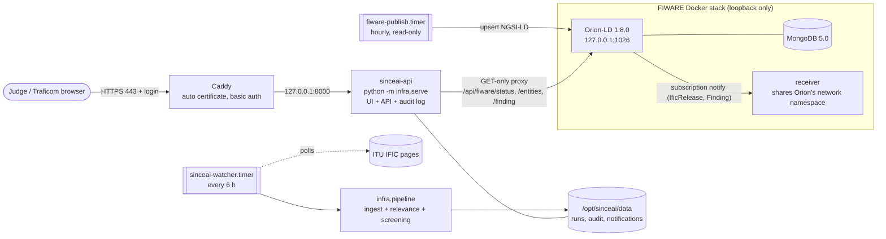

# What runs on the Vultr VM, and why

One VM (`sinceai-2026-batch`, Frankfurt, 2 vCPU / 4 GB / 80 GB, Ubuntu 24.04, label `sinceai-2026`). Public ports: 22, 80, 443 only (`ufw`, checked by `health_check.sh`).
Everything else listens on loopback.

## Components
| Piece | Why it is on the VM |
|---|---|
| **Caddy** | HTTPS certificate with no domain purchase (sslip.io name), one login per person so the audit log says who approved |
| **sinceai-api** (systemd, `Restart=always`) | the product: one URL for judges instead of a laptop on venue Wi-Fi |
| **sinceai-watcher.timer** | keeps polling the ITU for new IFICs while every laptop is closed; runs the pipeline and posts the banner |
| **FIWARE stack** (Docker compose) | publishes the reviewed findings as NGSI-LD linked data (Finding to notice to station) and answers graph and geo queries; the app's case pop-up reads it through the read-only proxy |
| **fiware-publish.timer** | hourly upsert from the committed result files; never writes back into `results/` |
| **ufw** | deny incoming; allow 22/80/443 (rules are in `backend/setup_backend.sh`) |

## Memory budget (4 GB VM, measured Sun 8 Nov ~03:50 UTC; `health-check.txt`, `infra/fiware/evidence/vm/current/runtime.txt`)
| Process | Cap | Used |
|---|---|---|
| Orion-LD | 640 MB (`mem_limit`) | ~248 MB |
| MongoDB (WiredTiger cache 0.25 GB) | 512 MB | ~149 MB |
| receiver | 64 MB | ~12 MB |
| sinceai-api (python) | none | ~486 MB (systemd `MemoryCurrent`) |
| VM total | 3,910 MB | 2,450 MB available, 7.9 GB swap (49 MB used) |

Orion's cap was 384 MB until it was OOM-killed on 8 Nov: see `incident-orion-oom-20261108.md`.

## What we did not use, and why
- **Vultr managed database / object storage / Kubernetes / load balancer / GPU:** each bills extra and none is needed: the data are files plus a small Mongo, one process serves the app, the risk model is a small LightGBM surrogate trained in about two minutes on CPU.
- **A second VM or auto-scaling:** the demo has a handful of users; one VM is the cheapest honest sizing.
- **Vultr snapshots / managed backups:** the app is redeployable from git. We keep one `backup-app-*.tgz` per deploy for rollback (see `RUNBOOK.md`); the broker is rebuildable from the result files within seconds (`systemctl start fiware-publish`).
- **Terraform:** one VM created with `vultr-cli` (steps in `README.md`); the cloud-init and `setup_backend.sh` are the reviewable definition of what runs on it.
- **Monitoring/alerting service:** `health_check.sh` exists and was run by hand; nothing runs it on a timer yet (a known gap).
